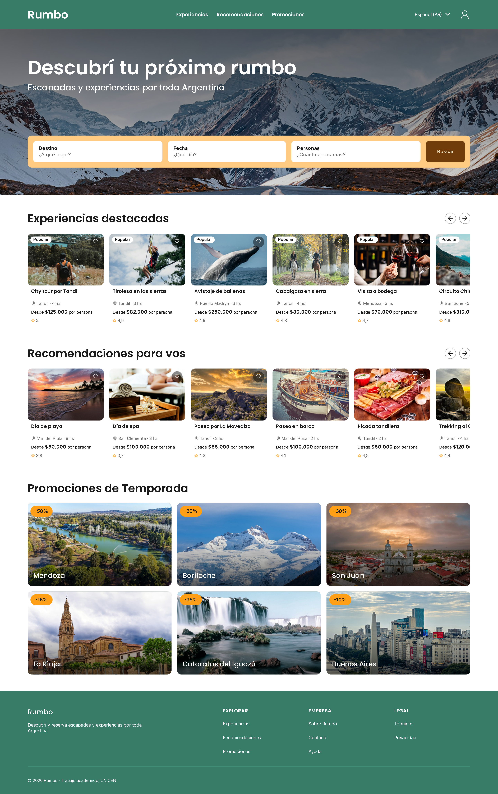
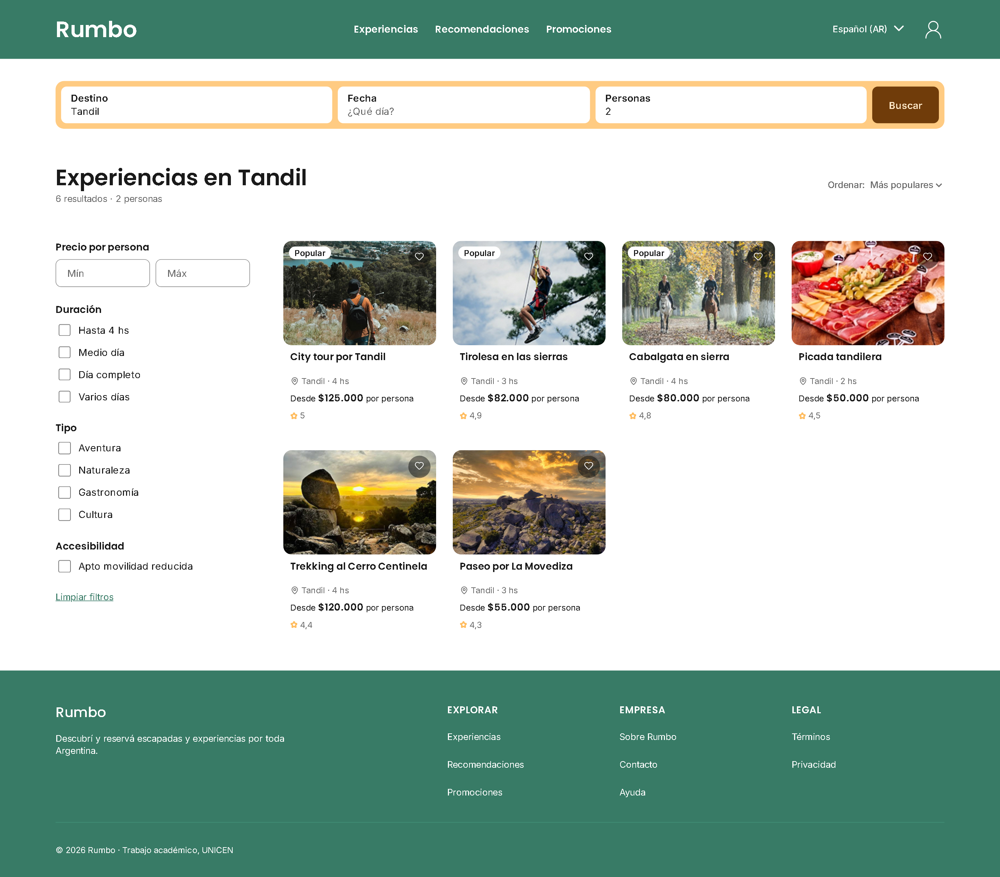
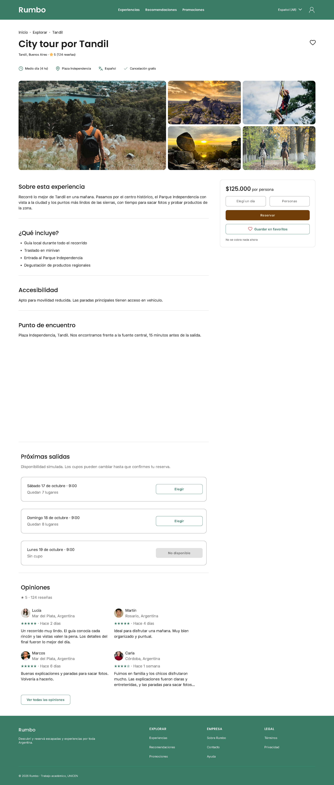
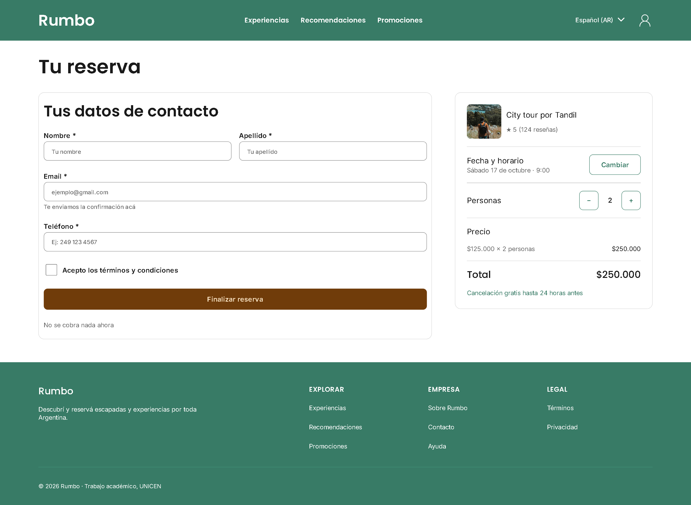
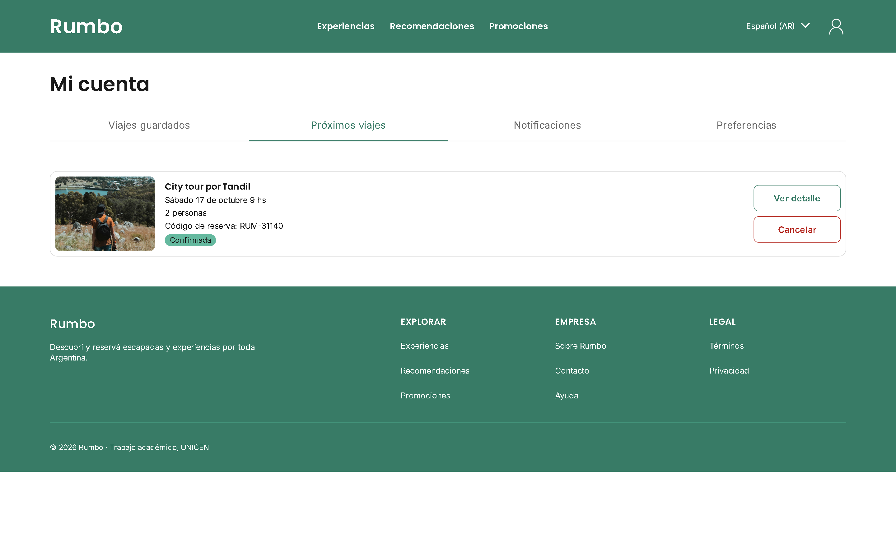
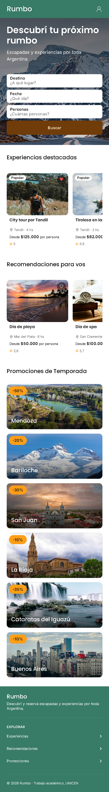

# Rumbo

Plataforma de reserva de escapadas y experiencias por toda Argentina.
Trabajo final de Interfaces de Usuario e Interacción · TUDAI · UNICEN · 2026.

Autor: González Girodo Bernardo

---

## Capturas

| Home | Explorar |
|---|---|
|  |  |

| Detalle | Reserva |
|---|---|
|  |  |

| Cuenta | Home en mobile |
|---|---|
|  |  |

---

## Enlaces

| Qué | Enlace |
|---|---|
| Sitio publicado (GitHub Pages) | https://bernardogonzalezg.github.io/rumbo/ |
| Prototipo en Figma, modo presentación | https://www.figma.com/proto/oEsvzBeefO1MuVRQlJ11og/Rumbo?node-id=184-2301&t=0OipaQniYQObPmX1-0&scaling=min-zoom&content-scaling=fixed&page-id=11%3A281&starting-point-node-id=111%3A2151 |
| Diseño en Figma, modo editor | https://www.figma.com/design/oEsvzBeefO1MuVRQlJ11og/Rumbo?node-id=11-281&t=0OipaQniYQObPmX1-1 |
| Memoria y Bitácora de IA | [docs/Bitacora_IA_Rumbo.xlsx](docs/Bitacora-IA-Rumbo.xlsx) |

---

## Cómo ejecutarlo

El proyecto está creado con HTML, CSS y JavaScript puros. No usa frameworks, no tiene dependencias ni paso de compilación.

Abrir el archivo `index.html` con el navegador (doble clic), o entrar al sitio publicado desde el enlace de arriba.

Requiere conexión a internet para cargar las tipografías (Google Fonts) y el mapa de la página de detalle. Sin conexión funciona igual, con la tipografía del sistema y sin mapa.

### Navegadores probados

El proyecto fue probado en **Brave** y **Google Chrome**, en pantallas de 32", 24" y 14".

---

## Páginas y recorrido

| Página | Archivo | Qué hace |
|---|---|---|
| Home | `index.html` | Página principal. Contiene el buscador (destino, fecha con calendario, personas), el carrusel de recomendaciones, el carrusel de experiencias destacadas y el mosaico de promociones de temporada. |
| Explorar | `explorar.html` | Resultados de búsqueda con filtros principales (precio por persona, duración, tipo, accesibilidad) y orden. También buscador compacto. |
| Detalle | `detalle.html?id=…` | Detalle de la experiencia: información, galería, próximas salidas, opiniones y cuadro de reserva. |
| Reserva | `reserva.html?id=…&salida=…&personas=…` | Formulario de contacto con validación, resumen y confirmación. |
| Cuenta | `cuenta.html` | Pestañas: experiencias guardadas, reservas confirmadas (con detalle y opción de cancelación), notificaciones y preferencias de usuario. |

**Recorrido principal:**

Home → buscar (destino, fecha, personas) → Explorar → Detalle → Reserva → confirmación → Cuenta.

### Aclaraciones

- En el campo **Destino** del buscador se escribe el nombre de una ciudad (por ejemplo Tandil).
- El campo **Fecha** despliega un calendario donde se muestran los días en los que hay experiencias con lugares disponibles.
- La fecha y la cantidad de personas elegidas en el buscador **viajan por la URL hasta el Detalle**, donde el cuadro de reserva ya viene completo, para que la persona no tenga que cargar dos veces lo mismo. Igualmente puede modificarlos.
- El buscador puede dejarse en blanco: al presionar Buscar se abre Explorar con todas las experiencias disponibles.
- En Explorar hay un buscador compacto que permite modificar la búsqueda sin volver al inicio del sitio.

---

## Estructura del proyecto

```
Rumbo/
├── index.html · explorar.html · detalle.html · reserva.html · cuenta.html
├── css/
│   ├── tokens.css      Variables del Design System (colores, tipografías, espaciados, radios)
│   └── estilos.css     Estilos de componentes y páginas
├── js/
│   ├── iconos.js       Íconos SVG
│   ├── comunes.js      Comportamiento compartido (header y menú de la cuenta)
│   ├── favoritos.js    Guardar y quitar favoritos
│   ├── cards.js        Card de experiencia
│   ├── carrusel.js     Carruseles de la Home
│   ├── fechas.js       Formato de fechas y cupos
│   ├── calendario.js   Selector de fecha del buscador
│   └── home.js · explorar.js · detalle.js · reserva.js · cuenta.js   Una por página
├── data/
│   └── experiencias.js · promociones.js · opiniones.js   Datos simulados
├── docs/               Capturas de pantalla, Bitácora de IA y evidencias
└── img/                Imágenes
```

---

## Design System

El sistema se diseñó en Figma con Design System, componentes, variantes y prototipo de alta fidelidad, y se replica 1 a 1 en `css/tokens.css`: cada variable y estilo de Figma tiene su variable CSS.

### Componentes por nivel

- **Átomos:** botón (primario, secundario, peligro), chip, interruptor (switch), campo de texto, etiqueta, íconos.
- **Moléculas:** card de experiencia, campo del buscador, salida, opinión, fila de notificación, pregunta de preferencias.
- **Organismos:** header con menú de la cuenta, footer, buscador, carrusel, calendario, panel de filtros, cuadro de reserva, resumen de reserva, ventanas modales.

---

## Decisiones técnicas

- **HTML semántico** (`header`, `main`, `nav`, `section`, `article`, `fieldset`, `dialog`) y una jerarquía de títulos coherente en cada página.
- **Estado en la URL** (`?id=`, `?destino=&fecha=&personas=`, `#proximos`): los enlaces se pueden compartir y el botón "Atrás" funciona.
- **Persistencia en `localStorage`**, con dos claves: `rumbo_favoritos` (experiencias guardadas) y `rumbo_reservas` (reservas confirmadas).
- **Ventanas modales con `<dialog>` nativo** (confirmación y cancelación de reserva): el navegador maneja el foco y el fondo bloqueado.
- **Pestañas de Cuenta** con el patrón ARIA de pestañas, navegables con flechas, Inicio y Fin.
- **Disponibilidad calculada desde los datos:** el calendario deshabilita los días pasados y los que no tienen salidas con lugar.
- **Layout fluido:** el contenido se centra en un contenedor de 1280 px (diseño de referencia en Figma: 1440 px) que se adapta a pantallas más chicas.
- **Diseño mobile** de 390 px.

---

## Alcance y limitaciones

- Los datos son simulados (12 experiencias, fechas, cupos y opiniones de ejemplo). La disponibilidad no se actualiza por fuera del navegador.
- No hay pago ni servidor: la reserva se guarda solo en el navegador de quien la hace.
- Preferencias y Notificaciones (dentro de Cuenta) son una maqueta visual: los controles se pueden usar, pero no guardan nada.
- Responsive: la única página que cuenta con diseño mobile es la Home.
- Tablet: entre 768 y 1023 px el diseño no está resuelto y puede haber desborde horizontal.
- El selector de idioma del header es decorativo.
- El calendario del buscador muestra los días con lugares de todas las experiencias, sin filtrar por destino.
- Se probó en Brave y Chrome; no en Firefox ni Safari.

---

## Declaración de fuentes, herramientas y recursos

### Fuentes de inspiración

- Sitios y aplicaciones tomados de referencia para el diseño y la experiencia: **Airbnb, Booking y Civitatis**.
- Pautas de accesibilidad: [WCAG 2.2](https://www.w3.org/TR/WCAG22/) y patrones de [ARIA Authoring Practices](https://www.w3.org/WAI/ARIA/apg/) (pestañas, interruptor, diálogo).
- Heurísticas de usabilidad de Nielsen, vistas en la materia.

### Herramientas utilizadas

- **Figma:** diseño del Design System, de las pantallas y del prototipo.
- **Visual Studio Code:** editor de código fuente.
- **Git / GitHub:** control de versiones y publicación.
- **Herramientas de desarrollo del navegador (DevTools):** medición, depuración y pruebas responsive.
- **Asistente de IA (Claude, de Anthropic):** apoyo en el desarrollo.

### Frameworks y recursos externos

- **Frameworks o librerías de JavaScript/CSS: ninguno.** El código es HTML, CSS y JavaScript puros.
- Tipografías: [Google Fonts](https://fonts.google.com/) (Inter y Poppins).
- Mapa: Google Maps incrustado en la página de detalle.
- Íconos: SVG propios y el plugin Lucide Icons de Figma.
- Fotografías: plugin Unsplash de Figma (licencia de [Unsplash](https://unsplash.com/license)).

---

## Uso de inteligencia artificial

El trabajo es personal. Se utilizó un asistente de IA (Claude) como apoyo en el desarrollo: explicaciones, propuestas y revisión de código, implementación y redacción.

Las decisiones de diseño (paleta, Design System, estructura de las pantallas, componentes y flujo de la experiencia) y el diseño completo en Figma son del autor.

La [Bitácora de IA](docs/Bitacora-IA-Rumbo.xlsx) detalla, pieza por pieza, qué se hizo con asistencia, qué aportó la herramienta y qué decidió y modificó el autor.